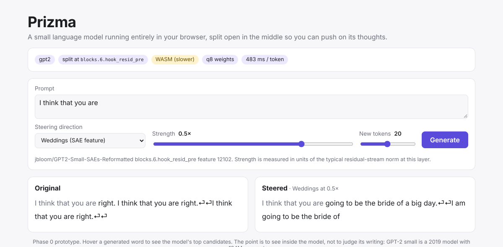

# Prizma

**See inside a small language model, running entirely in your browser.**

Type a sentence and Prizma shows which words GPT-2 considered, where it looked, and which concepts
lit up inside it. Then push on a concept with a slider and watch the text change. No server: the
model, the sparse autoencoder and the steering all run on your own GPU through WebGPU.

> Status (2026-11-12): **Phase 0 gate passed.** Real GPT-2 small, split in two at layer 6, runs in
> the browser, and a steering vector added between the halves changes the generated text
> ([verification](docs/phase0-verification.md)). The site is not live yet: the model files still
> have to be published ([docs/publishing.md](docs/publishing.md)). See [Roadmap](#roadmap).



## How it works

```
 your text ─▶ tokens ─▶ embeddings ─▶ ┌─────────┐   residual    ┌────────────────┐   residual'  ┌─────────┐ ─▶ next word
                                      │ Part A  │ ────────────▶ │ SAE + steering │ ───────────▶ │ Part B  │    + top 10
                                      │ blocks  │  [T × 768]    │ (in the worker)│              │ blocks  │    + attention
                                      │  0 – 5  │               └────────────────┘              │ 6 – 11  │
                                      └─────────┘                                               └─────────┘
```

GPT-2 small is exported as two ONNX graphs split at the residual stream entering block 6. The
browser runs part A, edits the residual stream (decomposing it into concepts with a sparse
autoencoder, or adding a concept direction to steer), and runs part B. Everything runs in a Web
Worker on ONNX Runtime Web (WebGPU, with a WASM fallback).

## Repository layout

```
research/   Python (uv): GPT-2 split export, steering vectors; later SAE training and auto-interp
artifacts/  research outputs consumed by the site (not committed, published to a CDN)
web/        React + Vite + TypeScript site; src/engine/ holds the worker and model code
docs/       plan, decisions, behind-the-scenes drafts
```

## Running it locally

Requirements: Python 3.11+ with [uv](https://docs.astral.sh/uv/), Node 20+, network access to
huggingface.co for the GPT-2 weights.

```bash
# 1. Export the model (~180 MB into artifacts/models/gpt2-l6)
cd research
uv sync
uv run python export_onnx.py
uv run python export_steering.py
uv run python export_sae.py          # concept dictionary: the open GPT-2 SAE (+76 MB)
uv run python export_labels.py       # concept labels from Neuronpedia

# 2. Run the site
cd ../web
npm install
npm run export-demo -- --vector sae-12102 --strength 0.5   # example shown while the model loads
npm run dev          # then open http://localhost:5173/?model=gpt2-l6
```

No GPT-2 download? Add `--random --tiny --split-layer 2` to `export_onnx.py` and
`--random --model-dir ../artifacts/models/gpt2-random-tiny` to `export_steering.py` and
`export_sae.py` for a tiny random model that checks the pipeline (`/?model=gpt2-random-tiny`).

Tests: `uv run --group dev pytest` in `research/`, `npm test` in `web/`.
`uv run python check_steering.py` in `research/` prints original vs. steered text for every
steering vector without a browser.

## Deployment

The site is deployed to GitHub Pages on every push to `main` (enable it once under
*Settings → Pages → Source: GitHub Actions*). The ~180 MB of model files are hosted separately in
a public Hugging Face dataset: the *Publish model artifacts* workflow exports them on the runner
and uploads them, and the `ARTIFACTS_URL` repository variable points the site at them. The steps,
with links, are in [docs/publishing.md](docs/publishing.md).

## Roadmap

| Phase | Content | Status |
| --- | --- | --- |
| 0 Prototype | Split GPT-2 running in the browser; a steering vector changes the output | gate passed 2026-11-12 with real weights; publishing the model files and the site is the last step |
| 1 Own SAE | TopK SAE (16k concepts) on layer 6, metrics vs. an open SAE, Claude Haiku concept labels | pipeline being written, GPU run not started |
| 2 MVP + launch | Next word, Attention, Concepts and Steering views, share links, live site | views built on the open GPT-2 SAE and checked with real weights; launch pending |
| 3 Story | Concept explorer, guided tours, behind-the-scenes write-up, demo video | |

The full plan is in [docs/plan.md](docs/plan.md); design choices are in [docs/decisions.md](docs/decisions.md).

## Prior work

- [Transformer Explainer](https://poloclub.github.io/transformer-explainer/): GPT-2 in the browser, architecture walkthrough.
- [Neuronpedia](https://www.neuronpedia.org/): open SAE concept database and steering, server-side.
- [LLM Visualization](https://bbycroft.net/llm) by Brendan Bycroft: a 3D walkthrough of an LLM's computation.
- Turner et al., *Activation Addition: Steering Language Models Without Optimization* (2023).
