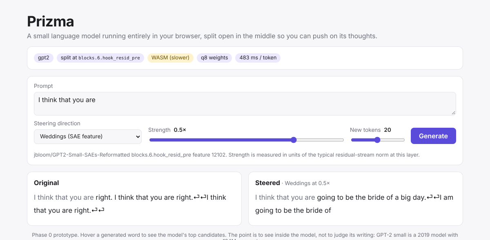
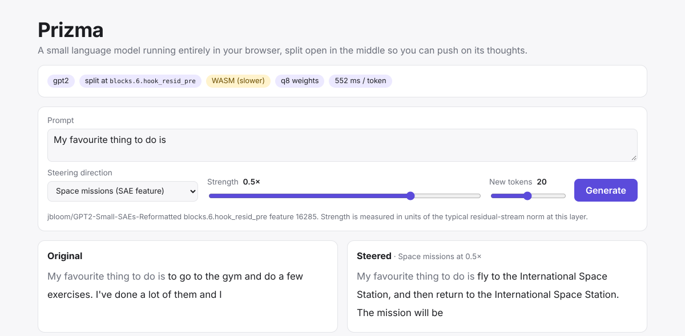

# Phase 0 gate: verification with real GPT-2 weights

Date: 2026-11-12. Gate from the plan: **steering visibly changes the output in the browser.**

**Result: passed.** Real GPT-2 small, exported by `research/export_onnx.py`, runs in Chromium and
a steering vector added between the two halves changes the generated text in every case tried.
Still open: speed on a real GPU through WebGPU, and Safari, which does not load the model yet
(see [Known problems and not verified](#known-problems-and-not-verified)).



## 1. The exported model matches Hugging Face GPT-2

`export_onnx.py` checks itself on 16 real sentences (155 token positions, each starting with
`<|endoftext|>`) and writes the numbers into `manifest.json`.

| | Top-1 agreement (all positions) | Last-token argmax equal | KL(HF ‖ export), mean | Greedy 12-token continuation identical | Max logit difference | Download |
| --- | --- | --- | --- | --- | --- | --- |
| fp32 graph (before quantization) | 100% | 16 / 16 | 3e-9 | 8 / 8 | 0.004 | |
| First real-weight export (symmetric q8 everywhere) | 91.0% | no | 1.3e-2 | 1 / 8 | 1.36 | 219.9 MB |
| **Current export** (q8 blocks, exact unembedding) | **98.7%** | **16 / 16** | **1.6e-04** | **7 / 8** | 0.45 | **179.2 MB** |

The first export with real weights was not faithful: the 0.04 drift reported earlier had been
measured on random weights. The cause was a single matrix. Quantizing the unembedding to 8 bits
costs about 60 times more KL than quantizing all 12 blocks together (measured by quantizing one
group of weights at a time). The likely reason is that next-token candidates are often less than
one logit apart while the logits themselves are large, so a 0.5% weight error is enough to reorder them.
Part B now reads the unembedding from the fp16 embedding table the browser downloads anyway
(GPT-2 ties the two), so the matrix is exact, it is not downloaded twice, and the total shrinks by
40 MB. See `docs/decisions.md` (2026-11-12).

The remaining difference comes from the 8-bit blocks: 2 of 155 positions have a different top-1
token, and one of eight greedy continuations diverges after 7 tokens.

## 2. Steering changes the text in the browser

Headless Chromium, `/?model=gpt2-l6&backend=wasm`, driven through the real UI (prompt box,
vector dropdown, strength slider, Generate). 20 new tokens, greedy decoding.
Model ready in 4.8 s from the local dev server; about 0.5 s per token on single-threaded WASM.

| Prompt | Vector | Strength | Original | Steered |
| --- | --- | --- | --- | --- |
| I think that you are | Love vs. hate (`love-hate`) | +0.5x | right. I think that you are right.⏎⏎I think that you are right.⏎⏎ | a great friend.⏎⏎I love you!⏎⏎I love you!⏎⏎I love |
| The weather today is | Happy vs. sad (`happy-sad`) | +0.5x | a bit different than it was yesterday.⏎⏎The weather is still pretty good, but it's | perfect for you to get ready for your next trip to the beach.⏎⏎The weather is perfect |
| I think that you are | Weddings (`sae-12102`) | +0.5x | right. I think that you are right.⏎⏎I think that you are right.⏎⏎ | going to be the bride of a big day.⏎⏎I am going to be the bride of |
| The weather today is | Christmas (`sae-6330`) | +0.5x | a bit different than it was yesterday.⏎⏎The weather is still pretty good, but it's | so good, and so is the season. I'm so happy to be here with my Santa, |
| My favourite thing to do is | Space missions (`sae-16285`) | +0.5x | to go to the gym and do a few exercises. I've done a lot of them and I | fly to the International Space Station, and then return to the International Space Station. The mission will be |
| My favourite thing to do is | Cooking and recipes (`sae-8888`) | +0.5x | to go to the gym and do a few exercises. I've done a lot of them and I | to soak for 5 minutes, stirring until the mixture is softened and then to a gentle simmer for about |
| I think that you are | God and faith (`sae-16860`) | +0.5x | right. I think that you are right.⏎⏎I think that you are right.⏎⏎ | the creator of this universe.⏎⏎I am the creator of the universe.⏎⏎I am |
| The weather today is | Weddings (`sae-12102`) | +1.0x | a bit different than it was yesterday.⏎⏎The weather is still pretty good, but it's | a day planner planner planner planner planner planner planner planner planner planner planner planner planner planner wedding day day day |
| My favourite thing to do is | Happy vs. sad (`happy-sad`) | -1.0x | to go to the gym and do a few exercises. I've done a lot of them and I | that I have to.⏎⏎I don't even have to.⏎⏎I don't even |

- Steering changed the text in **9 of 9** cases, with no console or page errors.
- The browser output is identical, token for token, to `research/check_steering.py`, which runs
  the same ONNX files in Python (9 of 9 cases, original and steered).
- WebGPU: the same model also loads and steers on Chromium's software WebGPU adapter
  (SwiftShader) and produces the same tokens as WASM. That adapter runs on the CPU, so its speed
  (12 s per token) says nothing about a real GPU.



## 3. SAE features and the strength that works

Five features of the open layer-6 SAE (`jbloom/GPT2-Small-SAEs-Reformatted`,
`blocks.6.hook_resid_pre`, 24,576 features) are in `steering.json`. They were found by running the
SAE on short texts about 16 topics, keeping features that fire on one topic only, reading their
Neuronpedia explanation, and then steering with them.

| Id in steering.json | Label | Neuronpedia explanation | On topic and readable at |
| --- | --- | --- | --- |
| `sae-12102` | Weddings | [references to wedding-related items and events](https://www.neuronpedia.org/gpt2-small/6-res-jb/12102) | 0.25x to 0.5x |
| `sae-6330` | Christmas | [phrases related to the Christmas holiday](https://www.neuronpedia.org/gpt2-small/6-res-jb/6330) | 0.5x to 0.75x |
| `sae-16285` | Space missions | [information related to space missions and spacecraft](https://www.neuronpedia.org/gpt2-small/6-res-jb/16285) | 0.25x to 1.0x |
| `sae-8888` | Cooking and recipes | [cooking instructions and recipes](https://www.neuronpedia.org/gpt2-small/6-res-jb/8888) | 0.25x to 0.5x |
| `sae-16860` | God and faith | [phrases related to religious references or faith in God](https://www.neuronpedia.org/gpt2-small/6-res-jb/16860) | 0.5x to 0.75x |

Strength is in units of the typical residual norm at the split (83.1 with BOS), so 0.5x adds a
vector of norm 42 at every position.

- **0.25x**: the topic appears in about half of the 15 runs, the text stays fluent.
- **0.5x**: the topic is clear in all 15 runs; 2 of them already repeat a word. This is the default.
- **0.75x**: on topic, but repetition is common.
- **1.0x and above**: the text collapses into one repeated word ("reception reception", "Eve Eve").
  Space missions is the exception and still reads as text at 1.0x.

So SAE vectors get a slider of [-1, 1] with a default of 0.5. The two ActAdd vectors (Love vs.
hate, Happy vs. sad) are clear at 0.5x, readable up to 1x and fall apart from 1.5x: slider
[-1.5, 1.5], default 0.5. Negative strengths push away from the concept. At -1x, Love vs. hate
produced text about "a white man" on two of three prompts, which is worth a look before the site
is public.

Other candidates that were looked at: anger (6415) and musical instruments (17946) work but less
clearly; military conflict (5919) works well but is grim for a demo; Paris (9191) drifts into
"Paris attacks"; "non-English text" (21709) only produces noise.

<details>
<summary>Full sweep: five SAE features, three prompts, four strengths (Python run of the exported ONNX files)</summary>

| Prompt | Vector | Strength | Continuation |
| --- | --- | --- | --- |
| I think that you are | (original) | 0 |  right. I think that you are right.⏎⏎I think that you are right.⏎⏎ |
| The weather today is | (original) | 0 |  a bit different than it was yesterday.⏎⏎The weather is still pretty good, but it's |
| My favourite thing to do is | (original) | 0 |  to go to the gym and do a few exercises. I've done a lot of them and I |
| I think that you are | Weddings | +0.25x |  right. I think that you are right.⏎⏎I think that you are right.⏎⏎ |
| The weather today is | Weddings | +0.25x |  a bit different than the one we had yesterday.⏎⏎The weather is a bit different than the |
| My favourite thing to do is | Weddings | +0.25x |  to have a wedding reception. I love it so much. I'm going to have a big party |
| I think that you are | Weddings | +0.50x |  going to be the bride of a big day.⏎⏎I am going to be the bride of |
| The weather today is | Weddings | +0.50x |  a little bit different than the one we had last year.⏎⏎The bride and groom are going |
| My favourite thing to do is | Weddings | +0.50x |  to have a wedding reception. I'm going to be a reception reception reception reception reception reception reception reception |
| I think that you are | Weddings | +0.75x |  going to be the day planner planner.⏎⏎I am planning to day planner.⏎⏎I |
| The weather today is | Weddings | +0.75x |  a day of celebration, and I'm going to be the reception reception reception reception reception reception reception reception |
| My favourite thing to do is | Weddings | +0.75x |  to day planner. I am planning to day planner. I am planning to day planner.⏎⏎ |
| I think that you are | Weddings | +1.00x |  planning to day reception reception reception reception reception reception reception reception reception reception reception reception reception reception reception reception reception |
| The weather today is | Weddings | +1.00x |  a day planner planner planner planner planner planner planner planner planner planner planner planner planner planner wedding day day day |
| My favourite thing to do is | Weddings | +1.00x |  anniversary day.⏎⏎I was planning to to day reception reception reception reception reception reception reception reception reception |
| I think that you are | Christmas | +0.25x |  right. I think that you are right.⏎⏎I think that you are right.⏎⏎ |
| The weather today is | Christmas | +0.25x |  so cold that I'm not sure if I'll be able to get my hands on a pair of |
| My favourite thing to do is | Christmas | +0.25x |  to make a cake. I love to make cakes, and I love to make them. I love |
| I think that you are | Christmas | +0.50x |  right to be happy with the Christmas tree. I am so happy with the Christmas tree. I am |
| The weather today is | Christmas | +0.50x |  so good, and so is the season. I'm so happy to be here with my Santa, |
| My favourite thing to do is | Christmas | +0.50x |  to make a Christmas tree tree tree tree tree tree tree tree tree tree tree tree tree tree tree tree |
| I think that you are | Christmas | +0.75x |  the present and present Day present, and I am so happy.⏎⏎I am so happy. |
| The weather today is | Christmas | +0.75x |  a big present for me, and I am so happy to be with you. I am so happy |
| My favourite thing to do is | Christmas | +0.75x |  with is.⏎⏎And I was so happy with my presents, and I was so happy with |
| I think that you are | Christmas | +1.00x |  a present present, Eve Eve Eve Eve Eve Eve Eve Eve Eve Eve Eve Eve Eve Eve Eve Eve |
| The weather today is | Christmas | +1.00x |  Eve Eve Eve Eve Eve Eve Eve Eve Eve Eve Eve Eve Eve Eve Eve Eve Eve Eve Eve Eve |
| My favourite thing to do is | Christmas | +1.00x |  with is, Eve Eve Eve Eve Eve Eve Eve Eve Eve Eve Eve Eve Eve Eve Eve Eve Eve |
| I think that you are | Space missions | +0.25x |  right.⏎⏎The first thing that comes to mind is the fact that the sun is about to |
| The weather today is | Space missions | +0.25x |  getting better and better, but the sun is still shining.⏎⏎The sun is about to enter |
| My favourite thing to do is | Space missions | +0.25x |  to take a picture of the sun and then take a picture of the moon. I'm not sure |
| I think that you are | Space missions | +0.50x |  about to land on the moon, and it's about to land on the moon's closest approach to |
| The weather today is | Space missions | +0.50x |  getting closer to the sun, and the first ever mission to the Sun's closest approach ever is scheduled |
| My favourite thing to do is | Space missions | +0.50x |  fly to the International Space Station, and then return to the International Space Station. The mission will be |
| I think that you are | Space missions | +0.75x |  the first to ever fly on the moon, and the first to ever fly, and the first to |
| The weather today is | Space missions | +0.75x |  about to fly by the International Space Station, and the first ever mission to the Red Planet, the |
| My favourite thing to do is | Space missions | +0.75x |  fly by the moon, and the second mission will be the closest ever to the sun, the second |
| I think that you are | Space missions | +1.00x |  the first ever mission to the International Space Station, and the mission will be the largest ever to ever |
| The weather today is | Space missions | +1.00x |  the closest ever to the solar mission, the mission's primary mission, and is the largest ever to |
| My favourite thing to do is | Space missions | +1.00x |  the flyby mission, which is the closest ever to the sun, and the second mission, the |
| I think that you are | Cooking and recipes | +0.25x |  going to need a little bit of water to boil for a few minutes. I also added a little |
| The weather today is | Cooking and recipes | +0.25x |  perfect for the baking to soften and then add to the pan.⏎⏎Add the butter and whisk |
| My favourite thing to do is | Cooking and recipes | +0.25x |  to mix the milk and the sugar in a large bowl. Add the milk and the sugar and mix |
| I think that you are | Cooking and recipes | +0.50x |  about 5 minutes. Add the milk and the cream to a medium-high heat. Add the milk |
| The weather today is | Cooking and recipes | +0.50x |  a little bit of a little bit of water, but the mixture is softened and the mixture to combine |
| My favourite thing to do is | Cooking and recipes | +0.50x |  to soak for 5 minutes, stirring until the mixture is softened and then to a gentle simmer for about |
| I think that you are | Cooking and recipes | +0.75x |  for 1-1-2-2-2-2-2-2-2-2 |
| The weather today is | Cooking and recipes | +0.75x |  a little bit of the pan for a medium-heat for a medium-heat for a medium- |
| My favourite thing to do is | Cooking and recipes | +0.75x |  to combine the water for a medium-bopped for 2-1/2-1/2 |
| I think that you are | Cooking and recipes | +1.00x |  for 1-1-2-2-2-2-2-2-2-2 |
| The weather today is | Cooking and recipes | +1.00x |  a medium-bopped for 2-2, 2-2, 2-2, 2- |
| My favourite thing to do is | Cooking and recipes | +1.00x |  to add the water for a medium-bobo (about 1/2-1/2- |
| I think that you are | God and faith | +0.25x |  right that the Bible is the word of God. I think that you are right that the Bible is |
| The weather today is | God and faith | +0.25x |  so good that we can't help but wonder if the sun is going to be there tomorrow.⏎ |
| My favourite thing to do is | God and faith | +0.25x |  to make a big deal out of it. I love to make things, and I love to make |
| I think that you are | God and faith | +0.50x |  the creator of this universe.⏎⏎I am the creator of the universe.⏎⏎I am |
| The weather today is | God and faith | +0.50x |  so good that we can make the world's plan for us.⏎⏎God's plan is that |
| My favourite thing to do is | God and faith | +0.50x |  to create a perfect God.⏎⏎I am the creator of all, and I am the creator |
| I think that you are | God and faith | +0.75x |  the creator of the creation of the, the, the, the, the, the, the, |
| The weather today is | God and faith | +0.75x |  so great that we created the creation of the Son's plan.⏎⏎God's plan is the |
| My favourite thing to do is | God and faith | +0.75x |  create.⏎⏎I created the Word's plan, and created the Word's plan for us. |
| I think that you are | God and faith | +1.00x |  the's's's's's's's's's's's's's's's's's's's |
| The weather today is | God and faith | +1.00x | 's's's's's's's's's's's's's's's's's's's's |
| My favourite thing to do is | God and faith | +1.00x | 's's's's is's's's is's's's.⏎⏎('s's's) |

</details>

## 4. The live site

Sections 1 to 3 ran against the local dev server. On 2026-11-12, after the repository became
public, the same checks were repeated on <https://pbariskan.github.io/Prizma/> in headless
Chromium (WASM, the cloud machine has no GPU), with the model files coming from the Hugging Face
dataset (`huggingface.co` and `us.aws.cdn.hf.co`).

- **The model loads in Chromium.** It is ready 13 to 17 s after the page opens with an empty
  cache, at 0.4 to 0.6 s per token, with no console errors and no failed requests. Safari does
  not: see [Known problems and not verified](#known-problems-and-not-verified).
- **Steering gives the same texts as locally.** "I think that you are" continues with "right. I
  think that you are right." and, with Weddings (12102) at 0.5x, with "going to be the bride of a
  big day." "The weather today is" continues with "a bit different than it was yesterday." and,
  with Space missions (16285) at 0.5x, with "getting closer to the sun, and the first ever mission
  to the Sun's closest approach ever is scheduled".
- **The four views work.** The precomputed example can be explored while the model downloads.
  On a generated text, Next word, Attention and Concepts open, pointing at a word previews it and
  the panel returns to the selected word afterwards. "Steer with it" on a concept (" Paris" ->
  "mentions of Paris", 9191) opens the Steering view and rewrites the text, and a click on a
  steered word opens it in Concepts on the steered text.
- **A share link restores the screen.** The link copied there (`vector=sae-9191`, `strength=0.5`,
  `token=s16`, `view=concepts`, `concept=9191`) shows the same text, steering, word, view and
  pinned concept in a fresh tab.
- **The rest of the page.** An example start and the Enter key run the model, nothing scrolls
  sideways at 390 px width, and the dark colour scheme renders.

## Known problems and not verified

- **WebGPU on a real GPU.** The cloud machine has none. Open the site in Chrome on a laptop: the
  header should say `WebGPU` and a token should take tens of milliseconds, not half a second.
- **Safari does not load the model.** Reported on 2026-11-12 from Safari on macOS, on the live
  site: the page and the precomputed example appear, then starting the model stops with
  `RangeError: Maximum call stack size exceeded`. Everything in section 4 is Chromium only.
  The likely cause was found the same day: the tokenizer ships the GPT-2 vocabulary as one array
  literal with 50,256 entries, and JavaScriptCore needs more stack to build it than WebKit gives
  a worker, so the worker stops before any model file is requested. A fix that ships the
  vocabulary as JSON text is in pull request #6 (`docs/decisions.md` has the details once it is
  merged). It has not been confirmed in Safari yet: Safari cannot be run on the cloud machine.
- **Firefox.** Not run. It should fall back to WASM where WebGPU is missing.
- **Touch.** Only the layout was checked at phone width. On a real phone a tap selects a word, and
  the candidate popup of the Steering view has no touch equivalent.

## Reproduce

```bash
cd research && uv sync
uv run python export_onnx.py          # prints the fp32 and q8 checks, writes manifest.json
uv run python export_steering.py
uv run python check_steering.py       # every vector at its default strength
uv run python check_steering.py --vector sae-12102 --strengths 0.25 0.5 0.75 1
cd ../web && npm install && npm run dev   # http://localhost:5173/?model=gpt2-l6
```
